# Guía: el launcher Nothing en tu tele, desde el móvil

Con **WallHouse TV** cambias la pantalla de inicio de tu Android TV o Google TV por
**CleanYourTV · Nothing edition** (sin anuncios, sin red, estilo Nothing OS) sin ordenador. Todo se hace por Wi-Fi
desde un móvil Android y se puede deshacer.

Capturas de un Google TV Streamer (Google TV 14) y un Xiaomi con Android 16. En otras teles cambian los nombres de
los menús, pero los pasos son los mismos.

**Necesitas:** un móvil Android, la tele y el móvil **en la misma red Wi-Fi**, y unos 5 minutos.

## 1. Prepara la tele

1. **Activa el modo desarrollador:** Ajustes → Sistema → Información → baja hasta **Compilación del SO de Android
   TV** y pulsa OK **7 veces**, hasta que diga que ya eres desarrollador.
2. **Activa la depuración:** Ajustes → Sistema → **Opciones para desarrolladores** → **Depuración por USB** y
   **Depuración inalámbrica** (si tu tele no la tiene, **Depuración por red**).

## 2. Instala WallHouse TV en el móvil y busca la tele

Descarga el APK de la [última versión](https://github.com/TheWallHouse/wallhouse-tv/releases/latest) y ábrelo en el
móvil. La primera pantalla resume lo que vas a hacer: pulsa **Continuar**.

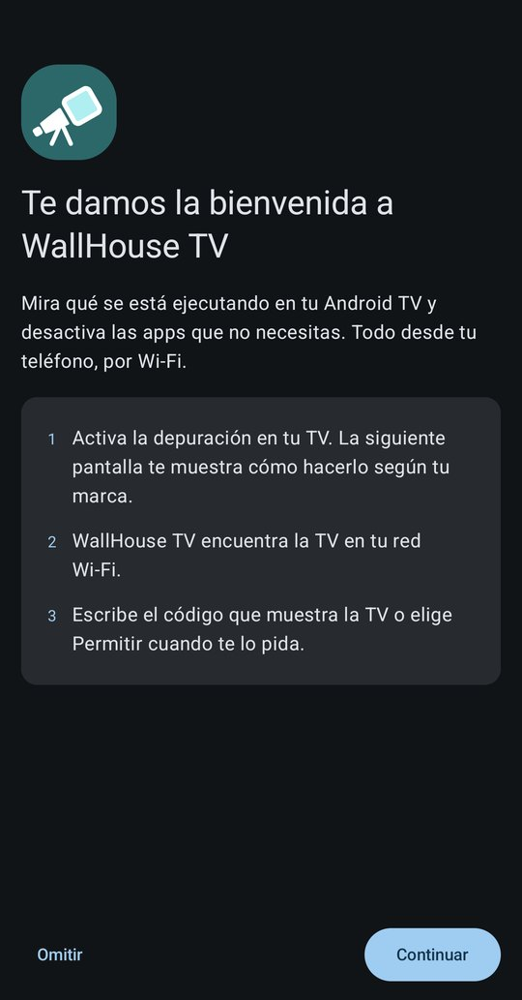

Elige el tipo de tele. WallHouse TV comprueba que el modo desarrollador y la depuración están activos y **busca las
teles de tu Wi-Fi**. Pulsa **Conectar** en la tuya.

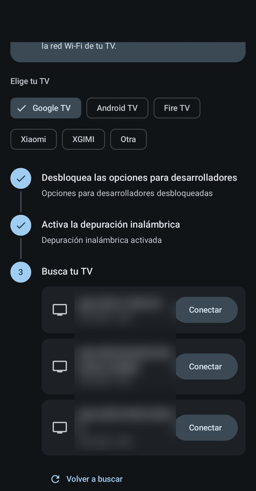

> Si no sale ninguna, **Volver a buscar** o **Añadir por dirección IP** (la IP está en Ajustes → Red de la tele).

## 3. Da permiso en la tele

Según la tele, verás una de estas dos cosas:

**Un código de vinculación** (Depuración inalámbrica → *Vincular dispositivo con un código*): escribe en el móvil
el código de 6 cifras que sale en la tele.

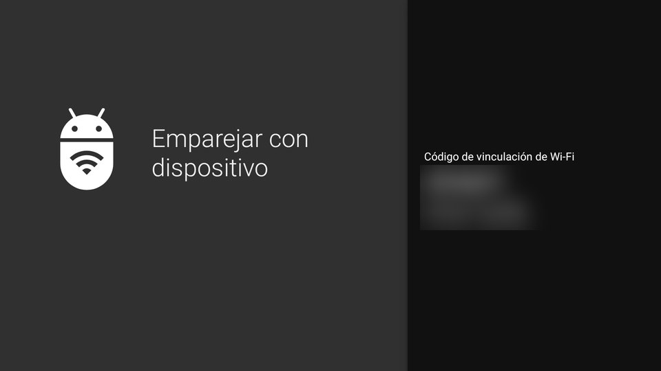

**Un aviso "¿Permitir depuración?"**: el móvil te enseña su clave para que compruebes que es la misma que sale en la
tele.

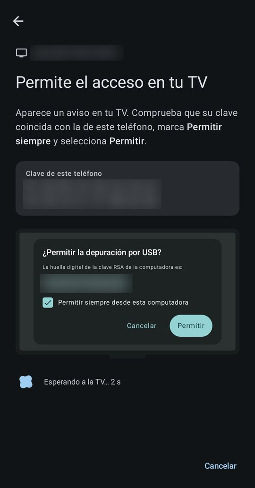

En la tele, marca **Permitir siempre desde este ordenador** y pulsa **Permitir**.

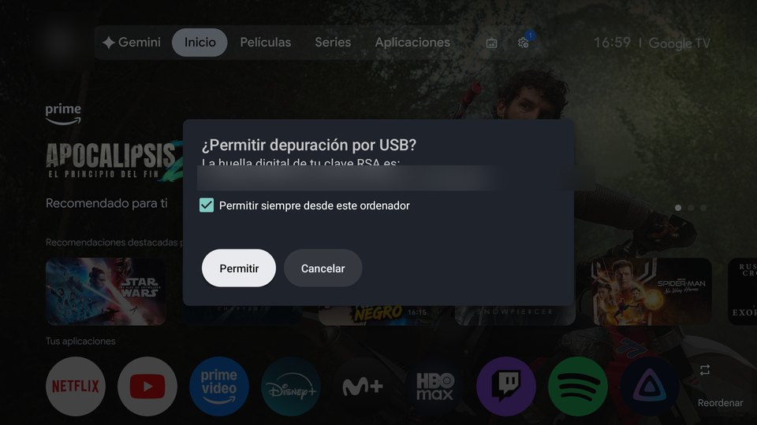

Ya estás dentro: el móvil muestra tu tele.

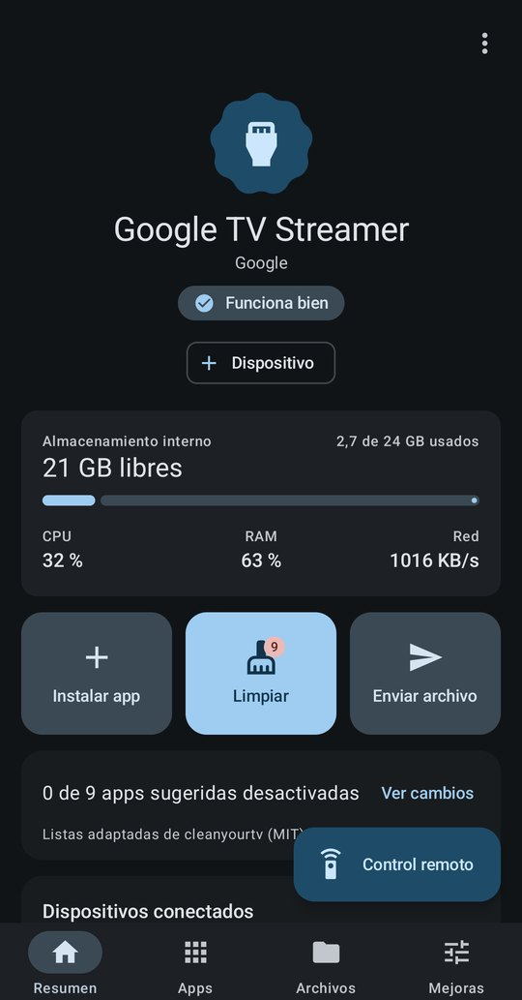

## 4. Instala el launcher Nothing

Ve a **Mejoras** → **Pantalla de inicio** → **Conseguir otro launcher** (o, en **Apps**, la tarjeta *Consigue una
pantalla de inicio mejor* → **Elegir uno**).

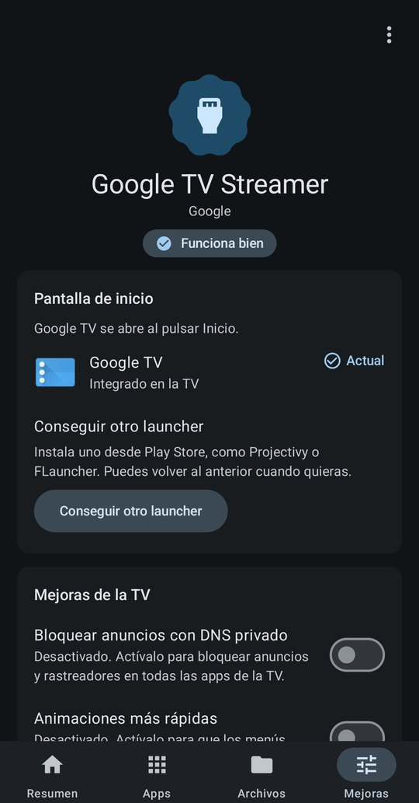

**CleanYourTV · Nothing edition** sale el primero. Elígelo y pulsa **Descargar e instalar**.

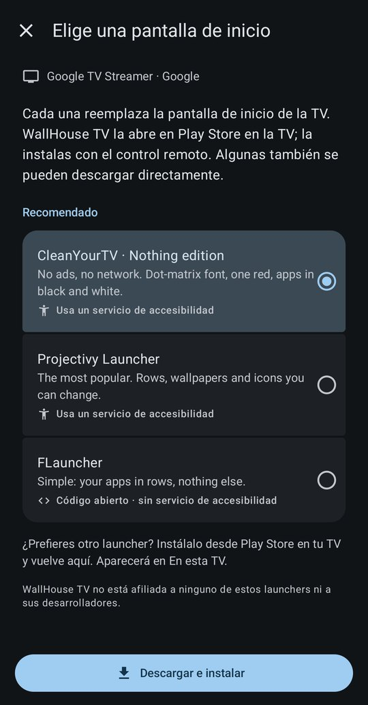

WallHouse TV te enseña **de dónde lo descarga** (su página de GitHub) y avisa de que comprobará que está firmado por
su desarrollador. Pulsa **Descargar e instalar** otra vez.

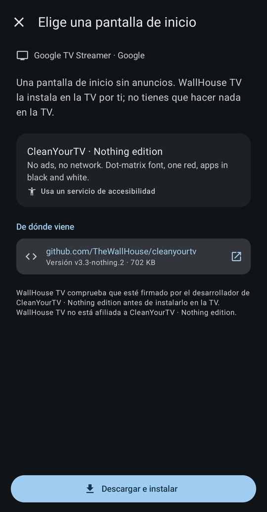

Lo descarga, **comprueba la firma** (si no coincide, no instala nada) y lo instala en la tele. Deja WallHouse TV
abierta hasta que termine.

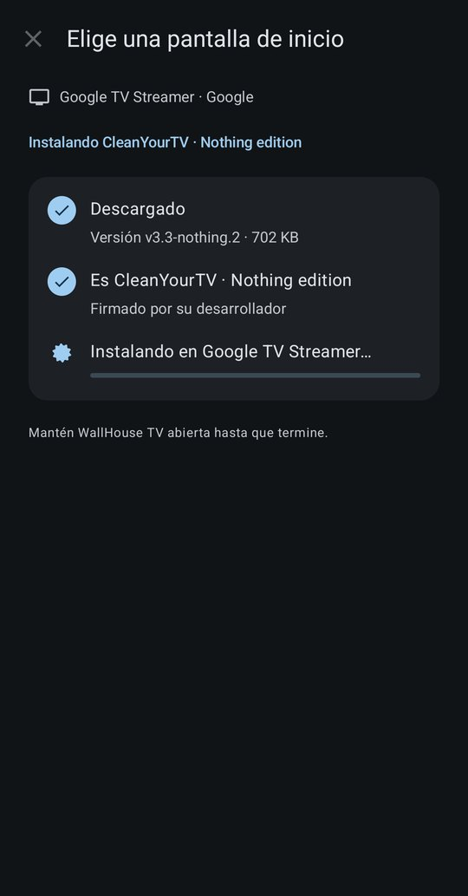

## 5. Ponlo como pantalla de inicio

Pulsa **Sí, cambiar la pantalla de inicio**. El texto explica qué cambia en tu tele; en un Google TV como este,
**no se desactiva nada**: el Google TV de siempre sigue debajo (y con él el Chromecast).

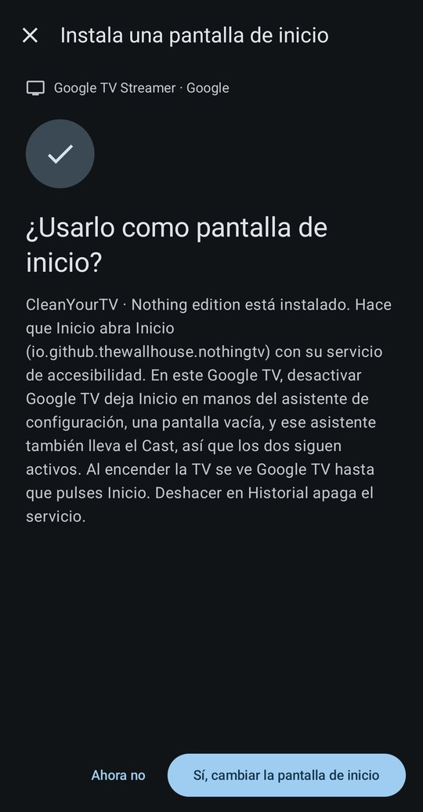

Después te pide activar su **servicio de accesibilidad**: es el que hace que el botón **Inicio** del mando abra el
launcher Nothing. Pulsa **Actívalo**.

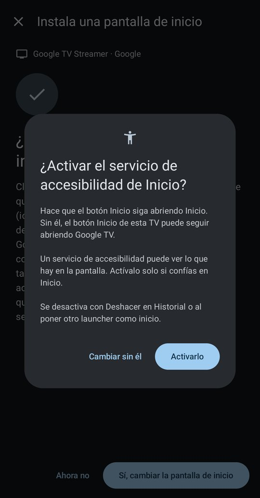

Listo: el móvil dice que es la pantalla de inicio. (En las capturas el launcher se llama *Inicio*; desde la versión
3.3-nothing.3 se llama **Nothing**.)

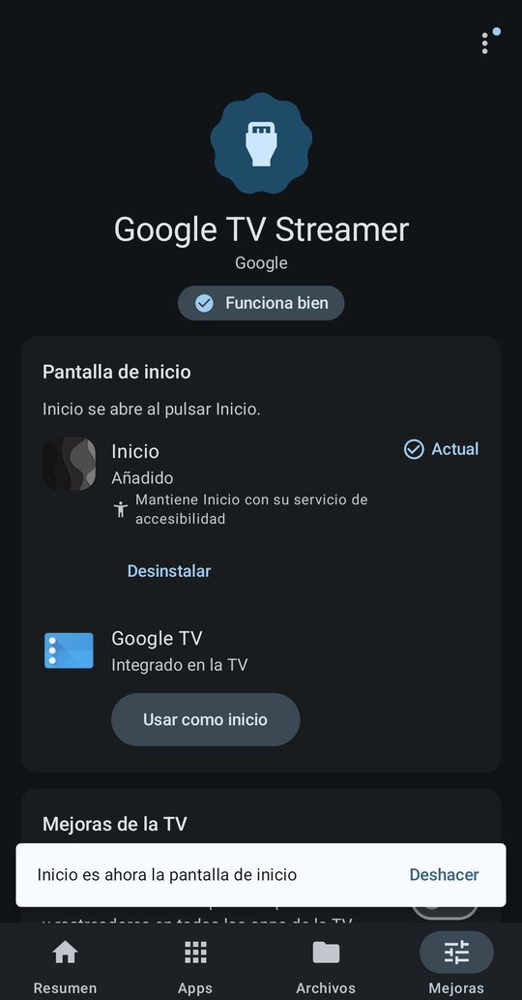

…y la tele ya lo muestra.

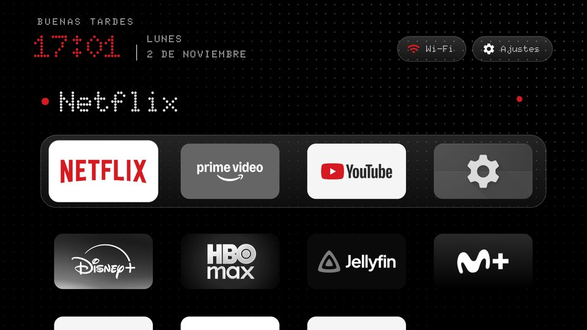

**Al terminar**, apaga la depuración en la tele (Opciones para desarrolladores) si no la vas a usar más.

## Volver al de siempre

En **Mejoras** → **Pantalla de inicio**, pulsa **Usar como inicio** en **Google TV** (o el launcher de tu tele). El
botón Inicio vuelve a abrirlo al momento. También puedes **Deshacer** cualquier paso desde el **Historial**, o
**Desinstalar** el launcher desde la misma pantalla.

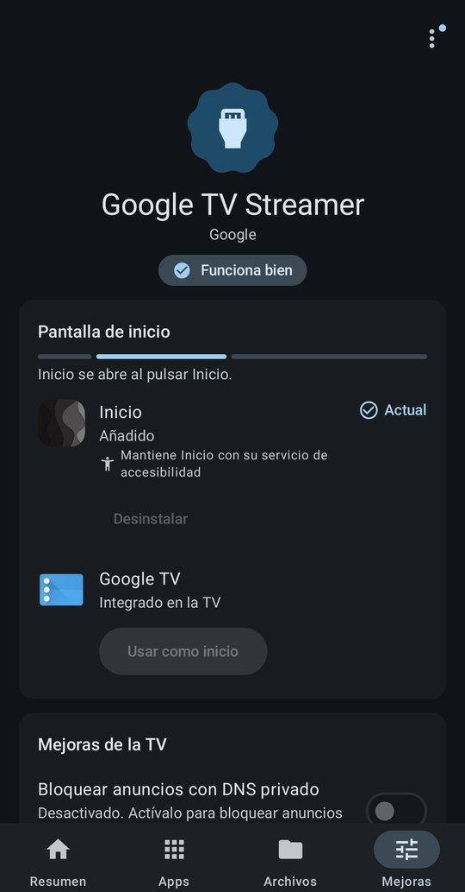

## Si algo no va

- **En un Google TV, al encender sale Google TV:** es normal. El launcher Nothing aparece en cuanto pulsas Inicio.
- **No encuentra la tele:** comprueba que móvil y tele están en el mismo Wi-Fi. Con una VPN en el móvil puede decir
  *No estás conectado a una red Wi-Fi*; si no la encuentra, apágala un momento.
- **El volumen del mando no va:** no es cosa del launcher. Configura el mando para que controle la tele por
  infrarrojos (Ajustes → Mandos y accesorios) y activa el control CEC en la tele.
