# Guide: WallHouse Launcher on your TV, from your phone

With **WallHouse TV** you replace your Android TV or Google TV home screen with **WallHouse Launcher**: no ads, no
network, seven looks. No computer: everything happens over Wi-Fi from an Android phone, and it can all be undone.

Screenshots from a Vestel Cosmos (Android TV 11) and a Xiaomi phone. Menu names change from TV to TV; the steps
don't.

**You need:** an Android phone, the TV and the phone **on the same Wi-Fi**, and about five minutes.

This is the TV before: the home screen it came with.

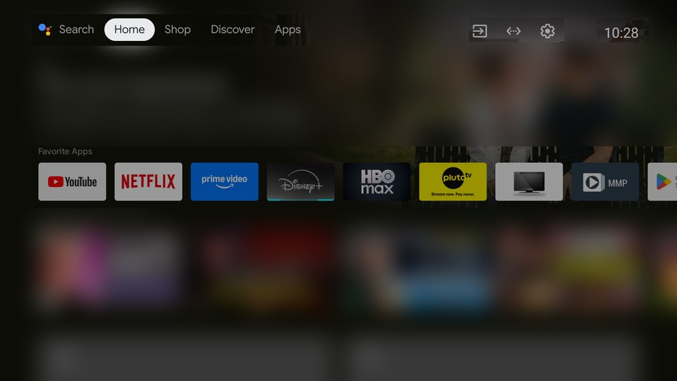

## 1. Get the TV ready

1. **Unlock developer options:** Settings → Device Preferences → About → go down to **Android TV OS build** and
   press OK **seven times**, until it says you are a developer.

   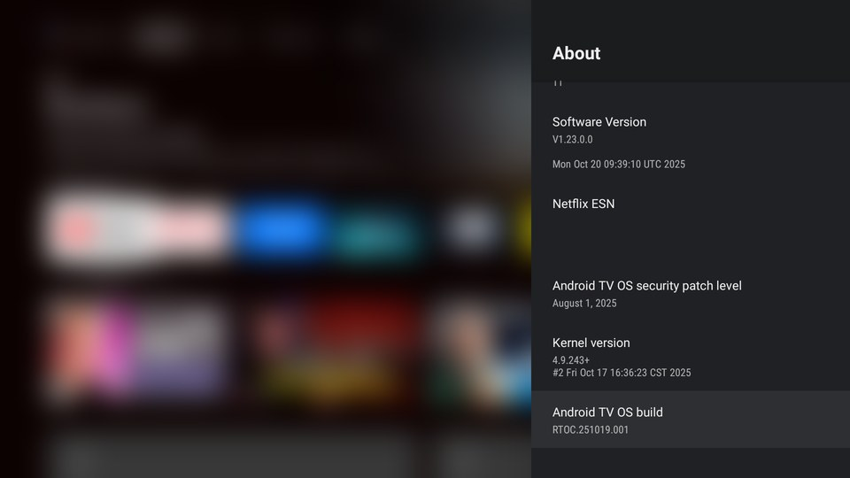

2. **Turn on debugging:** Settings → Device Preferences → **Developer options** → **USB debugging**. Turn on
   **Wireless debugging** or **Network debugging** too if your TV lists them; this one doesn't need them.

   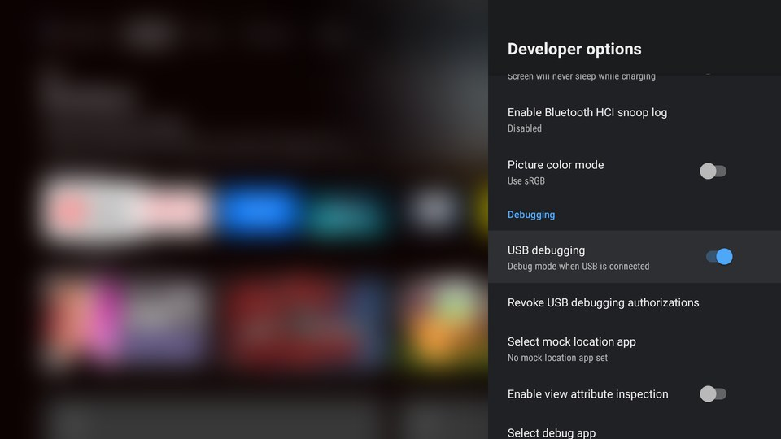

## 2. Install WallHouse TV and find the TV

Download the APK from the [latest release](https://github.com/TheWallHouse/wallhouse-tv/releases/latest) and open it
on the phone.

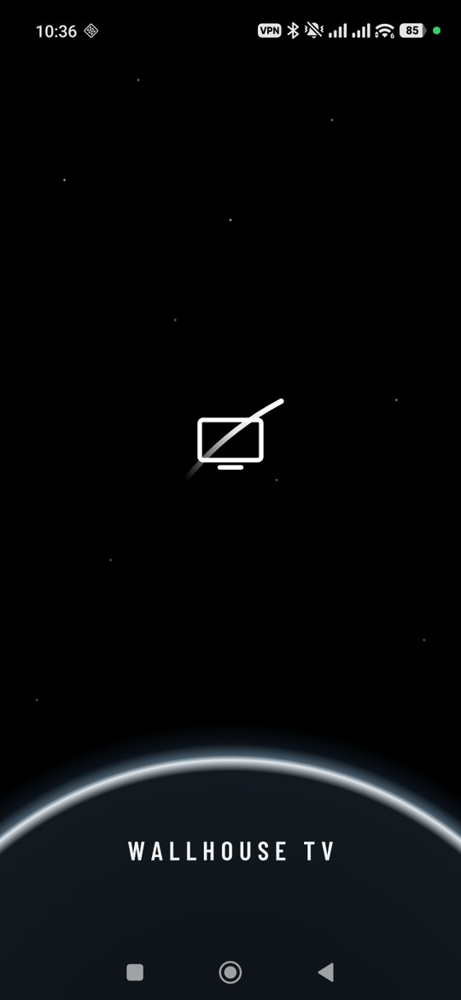 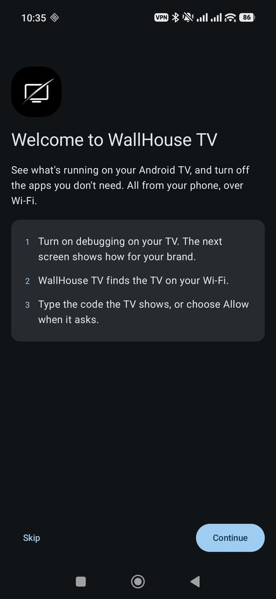

The first screen sums up what you are about to do: tap **Continue**. Pick your kind of TV; WallHouse TV checks that
developer options and debugging are on and **looks for TVs on your Wi-Fi**. Tap **Connect** on yours.

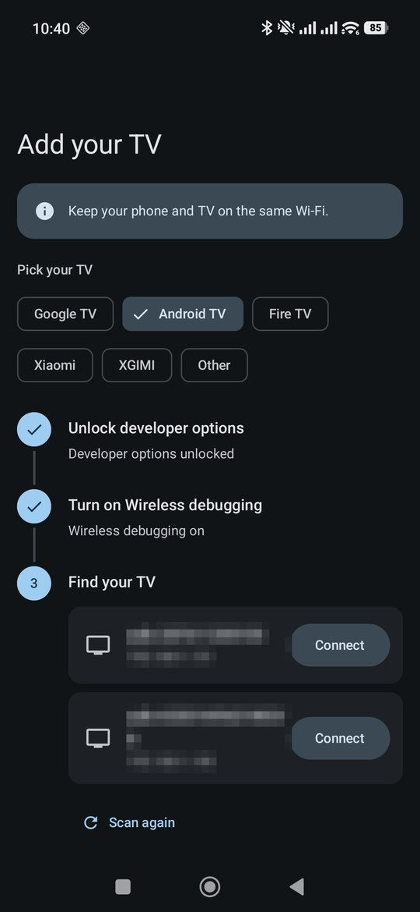

> None listed? **Scan again**, or add it by its IP address (on the TV: Settings → Network). A VPN on the phone can
> hide the TV: pause it for a moment.

## 3. Allow the phone on the TV

The phone shows its key and waits. A box pops up on the TV with the same key.

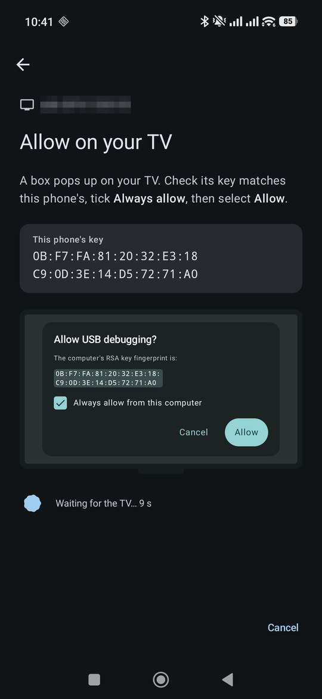

On the TV, tick **Always allow from this computer** and select **Allow**. (A TV with Wireless debugging may show a
pairing code instead: type it on the phone.)

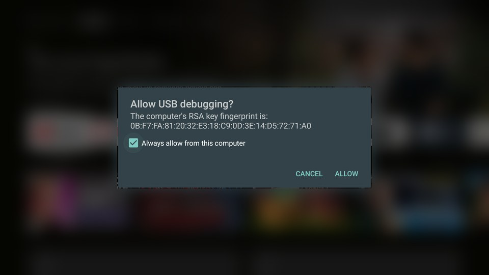

You're in: the phone shows your TV.

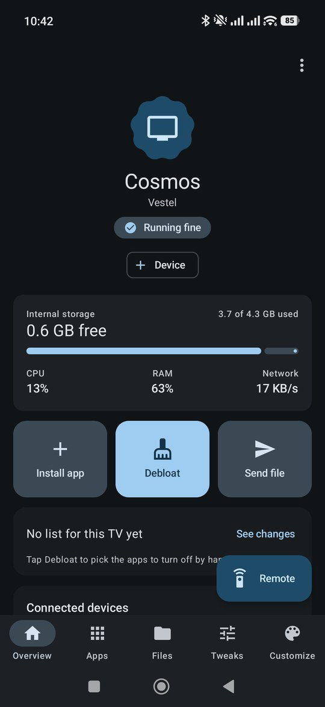

## 4. Install WallHouse Launcher

Go to **Tweaks** → **Home screen** → **Get another launcher**.

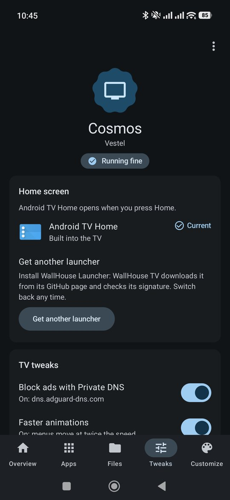

**WallHouse Launcher** comes first. Before anything downloads, the picker warns you if your TV is one where it won't
work or needs one more step (too old, a Fire TV, a TV made for China). Choose it and tap **Download and install**.

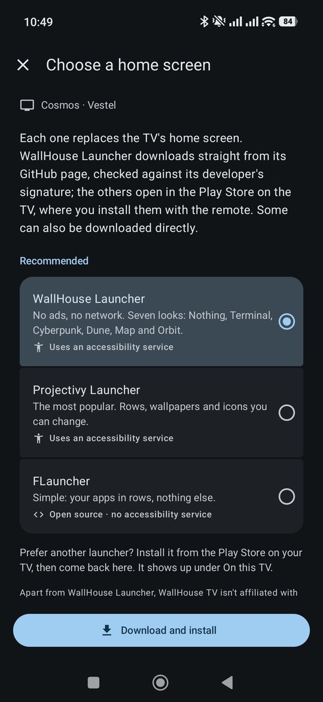

WallHouse TV shows **where it comes from**: this project's GitHub release. Tap **Download and install** again.

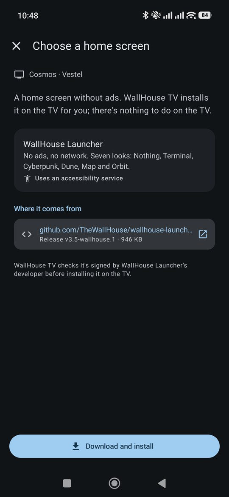

It downloads it, **checks it is signed by its developer** (if not, it installs nothing) and installs it on the TV.
Keep WallHouse TV open until it's done.

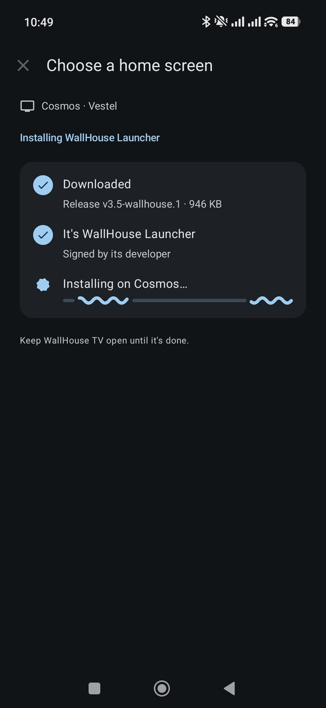

## 5. Make it the home screen

Tap **Yes, switch home screen**. The text says exactly what changes on your TV and how to undo it.

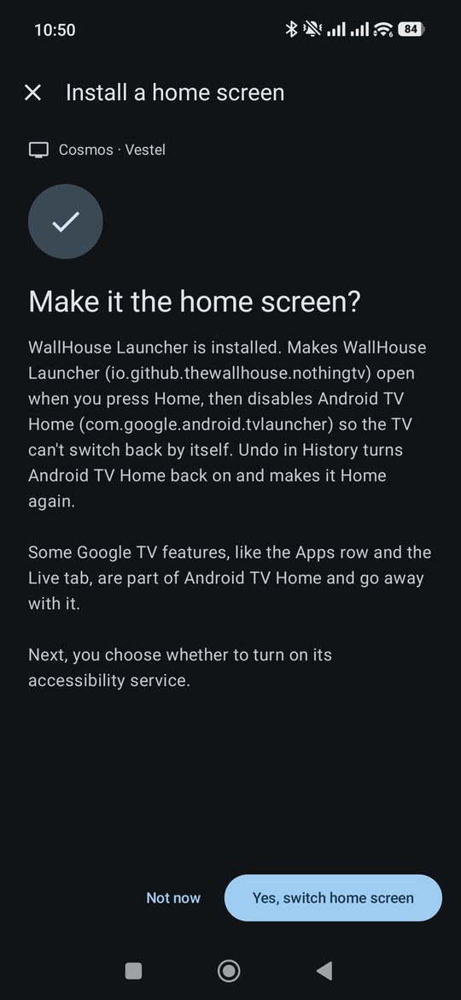

Then it asks about its **accessibility service**: it keeps the remote's **Home** button opening WallHouse Launcher.
Tap **Turn it on**.

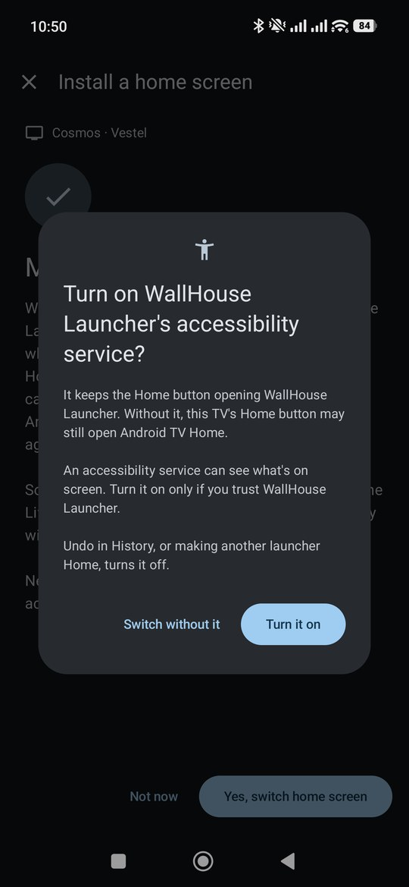

Done: the phone says it is the home screen…

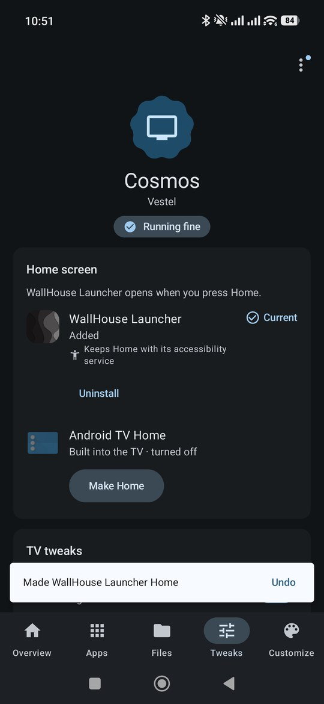

…and the TV shows it.

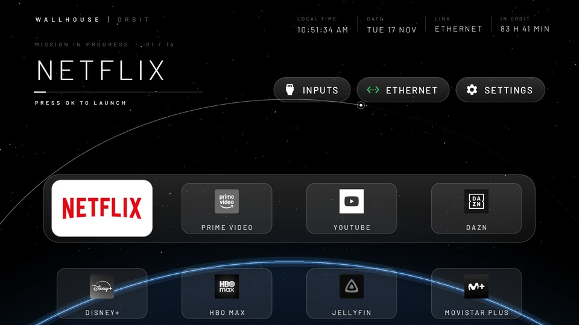

## 6. Make it yours

In **Customize**, pick one of the seven looks and its tone, a custom message after the greeting, the apps per row,
the dock and more. The TV changes at once. (On the TV itself: a long press on Settings opens Launcher settings.)

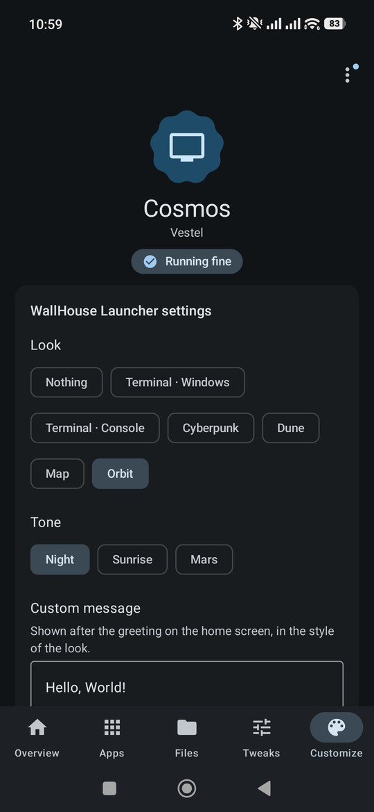

**When you're done**, turn debugging off on the TV (Developer options) if you won't use it again.

## Going back

In **Tweaks** → **Home screen**, tap **Make Home** on your TV's own launcher: Home opens it again at once. You can
also **Undo** any step from **History**, or **Uninstall** WallHouse Launcher from the same place.

## If something's off

- **On a Google TV, Google TV shows at power on:** that's normal. WallHouse Launcher appears as soon as you press
  Home.
- **It doesn't find the TV:** check the phone and the TV are on the same Wi-Fi, and pause any VPN on the phone.
- **The remote's volume doesn't work:** not the launcher's doing. Set the remote to control the TV by infrared
  (Settings → Remotes & Accessories) and turn on CEC on the TV.
